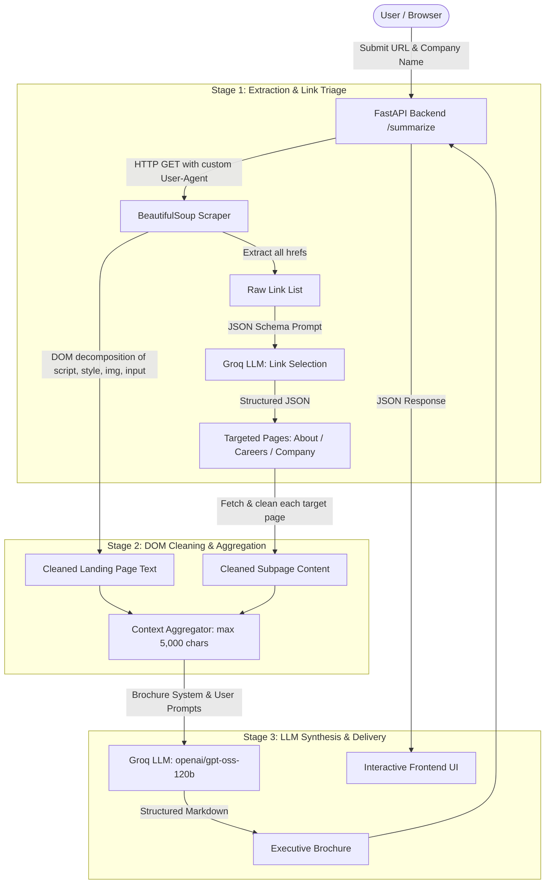

# AI Website Summarizer: Multi-Page Web Scraping & LLM Brochure Synthesis

[](https://www.python.org/)
[](https://fastapi.tiangolo.com/)
[](https://groq.com/)
[](https://groq.com/)

Transform any company or product website into an investor- and candidate-ready executive brochure in seconds. An automated multi-page extraction pipeline powered by BeautifulSoup DOM cleaning, JSON-guided intelligent link filtering, and ultra-fast inference via Groq (`openai/gpt-oss-120b`).

| Website Input & Intelligent Analysis | Structured Brochure-Style Summary |
|---|---|
|  |  |

## Why this project

A company's landing page only tells a fraction of the story. Crucial details about company culture, customer value propositions, tech stack, and career opportunities are scattered across distinct sub-pages (`/about`, `/careers`, `/company`). 

Manually navigating multiple tabs and copying text while filtering out advertisements, cookie banners, navigation menus, and scripts is slow and tedious. Feeding raw HTML into LLMs wastes tokens and pollutes the prompt with boilerplate.

This project automates intelligent web reconnaissance:
1. Crawls the landing page and extracts all candidate hyperlinks.
2. Uses an LLM in structured **JSON mode** to filter and triage only the most relevant sub-pages (e.g., About, Careers).
3. Strips non-content DOM elements (`<script>`, `<style>`, ``, `<input>`) to maximize content-to-token ratio.
4. Synthesizes landing page and sub-page content into a comprehensive, markdown brochure tailored for recruits, investors, and prospective clients.

## Architecture



## Two-Stage LLM Pipeline

Instead of naive single-page scraping or unguided broad crawling, the system employs a two-stage LLM workflow:

| Stage | Objective | Model Configuration | Output Format |
|---|---|---|---|
| **1. Link Selection** | Analyzes dozens of raw links to detect high-value target pages while discarding legal terms, privacy policies, and external anchors | `openai/gpt-oss-120b` via Groq | Structured JSON: `{"links": [{"type": "about page", "url": "..."}]}` |
| **2. Brochure Synthesis** | Merges multi-page excerpts into a balanced overview of company culture, products, customers, and opportunities | `openai/gpt-oss-120b` via Groq | Clean Markdown with headings, bullet points, and key takeaways |

### DOM Cleaning & Token Conservation

Raw HTML is notoriously noisy. To preserve context limits and keep latency low:
- BeautifulSoup removes `<script>`, `<style>`, ``, and `<input>` tags.
- Per-page text content is capped at 2,000 characters.
- Aggregate prompt payload is capped at 5,000 characters, preventing prompt overflow while preserving key semantic blocks.

## Features

- **Automated Multi-Page Crawling**: Doesn't just summarize the homepage — intelligently fetches and reads secondary pages like About and Careers.
- **Ultra-Fast LLM Inference**: Powered by Groq's LPU architecture running `openai/gpt-oss-120b`.
- **Intelligent Link Triage**: Uses LLM JSON response mode to select high-relevance pages without hardcoded regex patterns.
- **Clean, Modern Web Interface**: Single-page application built with a responsive terracotta and navy design system, interactive robot animation during loading, and pre-configured quick-test URL chips (Anthropic, Hugging Face, GitHub, OpenAI).
- **One-Click Actions**: Built-in clipboard copying and markdown file export.
- **RESTful API with OpenAPI Specs**: FastAPI backend with complete automatic docs at `/docs`.

## Tech Stack

| Layer | Technology | Purpose |
|---|---|---|
| **Backend Framework** | Python 3.11+, FastAPI | Asynchronous REST API routing, CORS handling, and static file serving |
| **LLM Inference** | Groq Cloud SDK (`openai/gpt-oss-120b`) | Multi-page link classification and structured brochure generation |
| **HTML Parsing & Scraping** | Requests, BeautifulSoup4 | Fetching remote web documents and DOM cleaning/filtering |
| **Data Validation** | Pydantic v2 | Request/response schema validation |
| **Frontend** | HTML5, Vanilla CSS3, ES6+ JavaScript | Lightweight client UI, zero build steps, custom animations, markdown rendering |
| **Configuration** | python-dotenv | Secure environment variable handling |

## Quick Start

### 1. Clone & Set Up Environment

```bash
# Clone the repository
git clone https://github.com/‹jr8281›/Ai-Web-Summarizer.git
cd "Ai-Website-Summarizer"

# Create and activate virtual environment
python -m venv .venv
source .venv/bin/activate       # Windows PowerShell: .venv\Scripts\Activate.ps1
```

### 2. Install Dependencies

```bash
pip install fastapi uvicorn pydantic requests beautifulsoup4 groq python-dotenv
```

### 3. Configure API Key

Create a `.env` file in the project or workspace root:

```env
GROQ_API_KEY=gsk_your_actual_groq_api_key_here
```

### 4. Run the Server

```bash
# Start FastAPI with Uvicorn from the repository root
python -m uvicorn "AI Web Summarizer.app:app" --reload --host 0.0.0.0 --port 8000
```

Open your browser at **`http://localhost:8000`** to interact with the web interface, or visit **`http://localhost:8000/docs`** for interactive Swagger documentation.

## API Reference

### `POST /summarize`

Generates an executive brochure summary for a given website URL.

**Request Body:**
```json
{
  "url": "https://github.com",
  "company_name": "GitHub"
}
```

**Response (200 OK):**
```json
{
  "summary": "## GitHub: The Complete Developer Platform\n\n### Overview\nGitHub is the world's leading AI-powered developer platform...",
  "model": "openai/gpt-oss-120b"
}
```

### `GET /health`

Health check endpoint to verify backend status and model configuration.

```json
{
  "status": "ok",
  "model": "openai/gpt-oss-120b"
}
```

## Project Structure

```
AI Web Summarizer/
├── app.py                 # FastAPI application, route handlers & LLM orchestration
├── scraper.py             # BeautifulSoup scraping functions & DOM cleaning
├── frontend/
│   └── index.html         # Single-page UI with terracotta styling & robot loader
├── Web Summarizer.ipynb   # Jupyter notebook used for initial prototyping & prompt tuning
├── README.md              # Project documentation
```

## Design Decisions

- **Two-Stage Agentic Crawling over Blind Scraping:** Scraping every link on a website leads to exponential request explosion and bloats LLM context with irrelevant information (legal terms, privacy policies, cookie disclaimers). Asking the LLM to inspect the link directory in JSON mode isolates the 2–3 most impactful pages.
- **Groq Cloud with `openai/gpt-oss-120b`:** Provides the reasoning depth required to understand multifaceted company information while maintaining low latency (~hundreds of tokens/sec) so users receive the full summary within seconds.
- **Zero-Dependency Vanilla Frontend:** The UI is crafted with vanilla HTML, modern CSS variables, and native JavaScript. This eliminates heavy node_modules build steps, speeds up local development, and allows instant loading without client-side hydration delays.
- **Defensive Scraping with Fallbacks:** The scraper strips out non-text elements and enforces strict character caps (`2,000` chars per page, `5,000` chars overall prompt limit) to prevent token window overflow.

## Limitations

- **JavaScript-Rendered SPAs:** Sites that require client-side execution (heavy React/Vue apps without server-side rendering) may return minimal HTML to `requests`. Adding a headless browser fallback (Playwright) is planned.
- **Anti-Bot Protections:** Some websites utilize Cloudflare Turnstile or CAPTCHA challenges that block standard automated HTTP requests.
- **Context Length Caps:** Text is truncated to avoid context window limits on very long corporate websites with extensive sub-pages.

## What I Learned

- **Token Economics & Pre-Processing:** Cleaning raw HTML before sending it to an LLM is far more cost-effective and accurate than relying on the LLM to ignore boilerplate. Stripping `<script>` and `<style>` tags cut input size by over 85%.
- **Constrained JSON Outputs:** Using `response_format={"type": "json_object"}` with Groq guarantees reliable parsing for multi-step agentic workflows without brittle regex post-processing.
- **User Experience During Multi-Step Latency:** Because multi-page scraping involves multiple sequential HTTP requests followed by LLM inference, transparent UI states (loading animations, informative progress indicators, and disable states) prevent users from double-submitting or abandoning requests.

